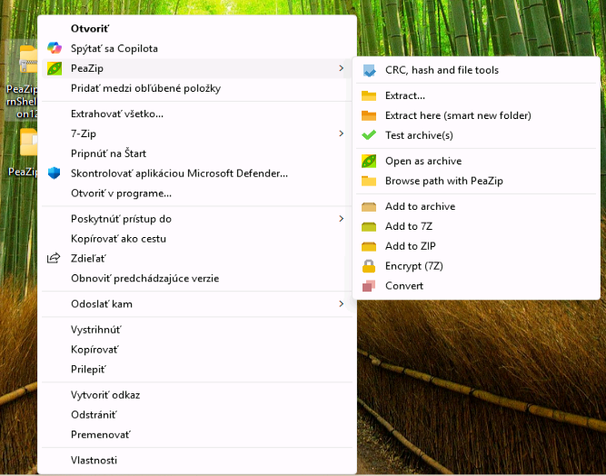

# PeaZip Modern Shell Extension — Community Companion

**Independent, unofficial Windows 11 Explorer extension for [PeaZip](https://peazip.github.io/).**  
**Source release candidate:** `v1.2.1` · Windows 11 x64, user-tested on 26H2 · PeaZip 11.4.0

This project registers an `IExplorerCommand` COM shell extension using a signed MSIX package, while leaving PeaZip itself installed or unpacked *outside* the package. An optional, **per-user Inno Setup** installer manages companion files and MSIX registration. PeaZip's existing CLI performs all archive operations: **PeaZip is not forked, modified, or redistributed here.**

> **Community status:** Not affiliated with or endorsed by the PeaZip maintainers. The source tree is prepared for review, **not a publicly signed, universally installable binary release**. The source archive includes no certificates, private keys, generated installers or PeaZip binaries. See [Release checklist](docs/RELEASE_CHECKLIST.md).

## Features

- Native **PeaZip → cascading submenu** in the Windows 11 Explorer context menu, with icons resolved from the existing PeaZip installation.
- The 12 classic operations: **Extract..., Extract here, Extract here (smart new folder), Extract here (in new folder), Open as archive, Browse path with PeaZip, Add to archive, Add to 7Z, Add to ZIP, Encrypt (7Z), Convert, CRC/hash/file tools**. Optional **Test archive(s)** is off by default.
- A standalone C++/Win32 configuration GUI: toggle individual commands, reorder them using **Move Up/Move Down**, reset to defaults, choose separators and archive detection.
- Per-user settings saved under `HKCU\Software\PeaZipModernMenu`. Changes are reflected on the next menu opening; no shell restart was required in the tester's environment.
- Per-user Inno Setup install/update/uninstall. MSIX update uses `-ForceTargetApplicationShutdown` when an older version is active. Installer preserves settings by default on uninstall.
- Both a traditionally installed PeaZip and **PeaZip Portable** can be targeted by configuring the exact `peazip.exe` path. Portable integration was also **successfully tested on a second Windows PC** with no prior PeaZip installation; the companion itself is installed, not portable.

## Screenshots

The eight screenshots below are provided by the tester. The files are included once each in `screenshots/`, unchanged from the supplied archive.

### Modern context menu

**Native PeaZip submenu for an archive in Windows 11**


**Native PeaZip submenu for a text document**


**Custom command ordering in the context menu**


**Context menu on Windows 11 26H2 (build 26300.9818)**


### Classic menu comparison

**Previous (classic) PeaZip context menu**



### Configuration

**Configuration window — command availability and ordering**


**Configuration window — additional settings**


### Windows settings

**Windows 11 26H2 — Settings / Personalization / Context menu**


## Verification and limitations

**Verified by a tester on Windows 11 26H2:** x64 MSVC build; MSIX signing with a locally trusted test certificate; Inno Setup build; clean install; in-place upgrade **1.2.0.0 → 1.2.1.0**; preservation of command configuration and order; operation of menu commands; uninstall followed by clean reinstall with preferences restored. On a **second PC** with no previous PeaZip installation, the tester confirmed successful operation with **PeaZip Portable** and the companion.

**Not yet verified:** deployment to a Windows device without first trusting the test certificate, public signing and timestamping, silent deployment, failure-path uninstall under artificially induced MSIX errors, a portable path containing spaces, and extensive Unicode/long-path/multi-select regression runs. See [Windows test matrix](tests/WINDOWS_TEST_PLAN.md).

The current package provides a **separate** menu. It does not remove Windows' built-in **Compress to** command. Extraction availability uses a filename-extension heuristic, not file-content detection. Virtual shell items are not supported. Extremely large selections and Windows command-line limits still apply. Other limitations are documented in [architecture](docs/ARCHITECTURE.md).

## Quick start (source build)

**Requirements**: Windows 11 x64; Visual Studio 2022 or 2026 Desktop Development with C++ and Windows SDK; Inno Setup 6/7 for an EXE installer; PeaZip 11.4.0 available separately.

From an ordinary x64 Windows Command Prompt:

```bat
cd /d "C:\path\to\PeaZip-ModernMenu"
tools\Build-x64.cmd
powershell.exe -NoProfile -ExecutionPolicy Bypass -File .\tools\Build-Inno.ps1
```

The wrapper selects x64 MSVC; direct builds in an x86 Developer Prompt are intentionally rejected. Outputs are placed under `out\` (git-ignored):

```text
out\PeaZip.ModernMenu.Community_1.2.1.0_x64.msix
out\stage\PeaZip.ModernShellExtension.dll
out\stage\PeaZipMenuConfig.exe
out\installer\PeaZip-ModernMenu-Setup-v1.2.1.exe
```

The default `Build-MSIX.ps1` signing mode is **LocalTest**. It creates/uses a self-signed **development** certificate *on your machine*. Neither this certificate nor the resulting installer is suitable for distributing to strangers. To create an unsigned package for inspection, use `tools\Build-x64.cmd -SignMode Unsigned` (it cannot be installed normally). For production certificate integration, read [Signing and distribution](docs/SIGNING_AND_DISTRIBUTION.md).

Run the static source checks using Python 3 (no external Python packages required):

```bat
py -3 tests\test_structure.py
py -3 tests\test_architecture_build.py
py -3 tests\test_inno_preprocessor.py
py -3 tests\test_maintenance_patch.py
py -3 tools\check_source_release.py
py -3 tools\Make-Source-Release.py
```

These tests check source contracts and package structure; they **do not replace compilation or runtime testing on Windows**.

## Install or update (developer/test environment)

1. Confirm the local MSIX signing certificate is **explicitly trusted on this test device**, or use a legitimately trusted production certificate. **Do not run unknown unsigned software or import an arbitrary unverified root certificate.**
2. Close Explorer windows and the configuration GUI; save other work (Windows may close the shell host during MSIX update).
3. Run `out\installer\PeaZip-ModernMenu-Setup-v1.2.1.exe` under the **same non-elevated Windows user** that owns the existing companion MSIX. The installer is per-user; avoid **Run as administrator** when it would change user identity.
4. Confirm registration:

```powershell
Get-AppxPackage -Name 'PeaZip.ModernMenu.Community' | Select-Object Name,Version,Status
```

On Windows 11 26H2 it may be necessary to enable the new extension under **Settings → Personalization → Context menu → Application extensions**. Exact UI wording can differ by language/build.

Open **Start → PeaZip Modern Menu → Configure menu** to change command visibility and order.

**Portable executable:** see [Portable integration](docs/PORTABLE.md). Use the **Browse** button to point to a stable unpacked `peazip.exe` location.

## Uninstall and rollback

Use **Windows Settings → Installed apps → PeaZip Modern Menu — Community Companion → Uninstall** under the same account. Choose **No** if asked to delete the companion settings and you want to restore preferences on a later install. This removes the companion MSIX registration and companion installer files; it does **not** remove PeaZip, archive files, classic shell integration, or the local test certificate.

Before uninstall, optionally back up preferences:

```powershell
reg.exe export "HKCU\Software\PeaZipModernMenu" "$env:USERPROFILE\Desktop\PeaZipModernMenu-backup.reg" /y
```

Downgrading is intentionally blocked. To revert to an older independently retained companion installer, first uninstall the current companion (preserving settings), then install the older one. See [architecture](docs/ARCHITECTURE.md) for package-identity constraints.

## Repository overview

- `src/` — standalone C++17 COM DLL, native GUI and minimal MSIX stub.
- `packaging/` — package manifest and placeholder branding assets.
- `installer/` — independent Inno Setup per-user companion installer.
- `tools/` — x64 build, signing, install/update and remove scripts.
- `tests/` — static source checks and manual Windows test plan.
- `docs/` — architecture, Portable integration, signing, contribution proposal and release checklist.

## Licensing and acknowledgements

The independent companion source code and project documentation are released under the **MIT License** (`LICENSE`), subject to the rights of their contributors and to the separate rights noted below. The `packaging/Assets` files are companion packaging images; confirm ownership or permission for these assets before public publication. The eight user-provided screenshots in `screenshots/` illustrate the software and may display PeaZip trademarks or interface elements; their inclusion does not imply endorsement by PeaZip.

**PeaZip is separate software**, developed by Giorgio Tani and distributed under the **LGPL-3.0** license. This extension does not redistribute PeaZip executables, archiving engines, or the PeaZip context-menu icons. Menu icons are referenced from the user's own PeaZip installation or portable folder at runtime. All third-party software, branding, and associated assets remain subject to their respective owners' terms. See [Source provenance and licensing](docs/PROVENANCE_AND_LICENSE.md).

**AI-assisted development disclosure:** This project was developed with assistance from **ChatGPT by OpenAI (GPT-6)**, including help drafting and revising C++/Win32 code, build and installer scripts, documentation, and troubleshooting. A human tester built the software and validated its behavior on Windows 11, including a second PC with PeaZip Portable. AI assistance is acknowledged transparently; it is not an assertion that OpenAI endorses, maintains, or holds the copyright to this repository. The people contributing and publishing the project remain responsible for code review, licensing, security, and releases.

**Unofficial project:** PeaZip Modern Shell Extension is an independent community project, **not affiliated with or endorsed by PeaZip, Giorgio Tani, or OpenAI**.

For upstream discussion, see [Proposal draft](docs/UPSTREAM_PROPOSAL.md) and [PeaZip contribution guidelines](https://github.com/peazip/PeaZip/blob/sources/CONTRIBUTING.md).
