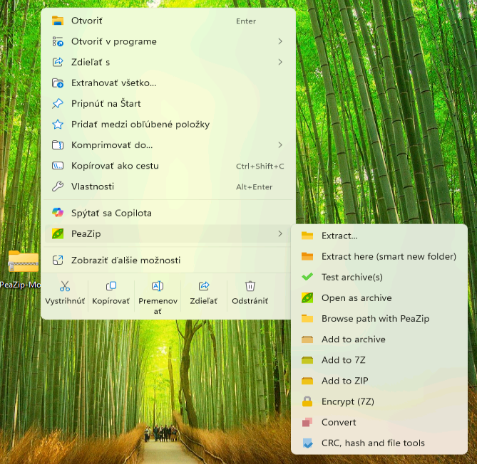
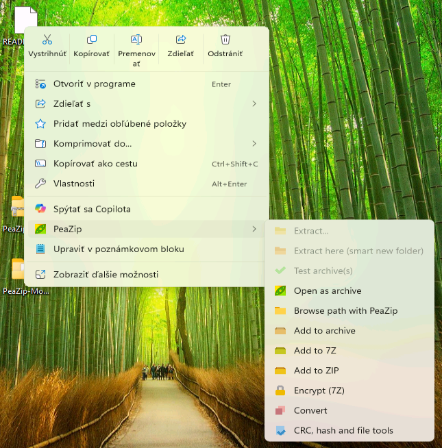
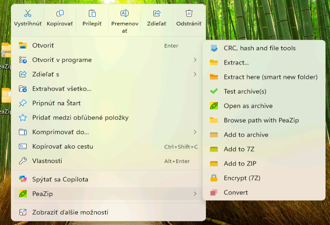
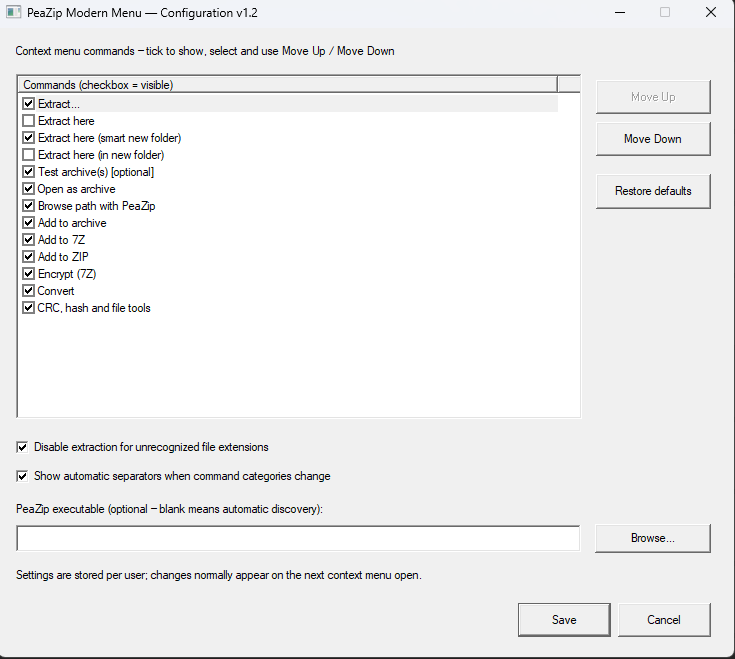
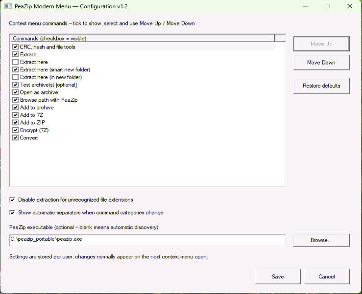

# PeaZip Modern Shell Extension — Community Companion

**Independent, unofficial Windows 11 context-menu extension for [PeaZip](https://peazip.github.io/).**  
**Stable release:** `v1.2.3` · Windows 11 x64

Provides a native PeaZip submenu in the modern Windows 11 File Explorer context menu through `IExplorerCommand` and a signed MSIX component. The companion uses PeaZip's existing command-line interface and **does not bundle, modify, or replace PeaZip**.

> **Community signing notice:** The ready-made setup EXE is not signed by a publicly trusted publisher. It bundles a self-signed MSIX and its **public** certificate. Setup explicitly asks for consent before adding that certificate to `LocalMachine\TrustedPeople`; administrator approval may also be required. This trusts other packages signed by the same key. **Do not proceed unless you trust this project and the download source.** No private signing key is shipped.

## Download and install (recommended)

**You do not need Visual Studio, Windows SDK, Inno Setup or PowerShell development commands.**

1. Visit **[GitHub Releases](https://github.com/FeroBoh/peazip-modern-shell-extension/releases/latest)** and download `PeaZip-ModernMenu-Setup-v1.2.3.exe` and `SHA256SUMS.txt`.
2. Compare the setup EXE's SHA-256 with the published value (instructions in [INSTALL.md](INSTALL.md)). Check the release page and repository carefully; a checksum on the same page is an integrity check, not independent publisher authentication.
3. Have **PeaZip installed**, or unpack **PeaZip Portable** separately.
4. Run the EXE under your normal Windows account. Read the self-signed certificate warning and consent only if you accept the security implications. If requested, approve UAC to trust the **public leaf** certificate (not a root CA).
5. In Windows 11 26H2, enable the extension if needed under **Settings → Personalization → Context menu → Application extensions**. Configure menu entries from the Start menu shortcut **PeaZip Modern Menu → Configure menu**. For Portable, browse to its `peazip.exe`.

**[Full user guide: INSTALL.md](INSTALL.md)** — setup, security warning, certificate trust, updates, uninstall, portable edition, and troubleshooting.

## Features

- Native cascading PeaZip context submenu with the familiar extract, compress, encrypt, convert, open and CRC/hash operations.
- Optional **Test archive(s)** command; type-aware extraction availability for common archive extensions.
- Native GUI to toggle menu items, change their order, restore defaults and select a custom `peazip.exe` location.
- Per-user settings in `HKCU\Software\PeaZipModernMenu`, usually applied on the next context-menu open.
- Updates via Inno Setup, with user preferences preserved. Full uninstall is managed by the **Community Companion** entry in Windows Installed apps.
- Works with a separately installed **PeaZip Portable**; the companion itself is not portable.

## Screenshots

The eight screenshots below are provided by the tester. The files are included once each in `screenshots/`, unchanged from the supplied archive.

### Modern context menu

**Native PeaZip submenu for an archive in Windows 11**

**Native PeaZip submenu for a text document**

**Custom command ordering in the context menu**

**Context menu on Windows 11 26H2 (build 26300.9818)**

### Classic menu comparison

**Previous (classic) PeaZip context menu**

### Configuration

**Configuration window — command availability and ordering**

**Configuration window — additional settings**

### Windows settings

**Windows 11 26H2 — Settings / Personalization / Context menu**

## What's new in v1.2.3

Built on the stable v1.2.2 installer and signing infrastructure, without the
experimental MSIX volume-switching code:

- **Add to ZIP** and **Add to 7Z** now include **all selected Explorer files
  and folders**, not just the right-clicked item.
- Our installer and uninstaller confirmation dialogs use consistent English
  **Yes / No** buttons (Windows-owned dialogs such as UAC remain localized).
- In-place upgrades from v1.2.2 preserve command settings and ordering.

See the single version history in [CHANGELOG.md](CHANGELOG.md).

**Known MSIX installation limitation:** On the tested Windows 11 computer, a
new installation failed when the system-wide default AppX volume was D:, but
succeeded when it was set to the Windows system volume C:. Once installed,
the extension continued working after the default was restored to D:. The
installer does not alter global AppX settings. See
[INSTALL.md — Known MSIX limitation](INSTALL.md#known-msix-limitation-non-system-default-appx-volume)
for checks and a manual, administrator-approved workaround.

## Building from source (developers / maintainers)

See **[BUILDING.md](BUILDING.md)** for the Visual Studio x64, Windows SDK, Inno Setup and community certificate procedure, static checks, local verification and release preparation.

Build outputs and developer certificates **must not** be committed. Only the maintainer holds the private signing key; public releases may include `.cer`, but never `.pfx`, `.p12` or private keys.

## Testing and limitations

**Reported as successfully tested by the project maintainer/tester on Windows 11:** v1.2.3 clean install with system AppX volume as default, upgrade from v1.2.2 with saved ordering/configuration, multi-select ZIP/7Z, other menu commands, English custom confirmation buttons, UAC/consent refusal, uninstall and optional certificate trust retention/removal. The signed MSIX and installed files were compared with the tested release build. See the [v1.2.3 release checklist](docs/RELEASE_CHECKLIST-v1.2.3.md).

**Known behavior:** Windows may list two entries, **PeaZip Modern Menu** (MSIX) and **PeaZip Modern Shell Extension – Community Companion** (Inno Setup). To remove both components and optionally revoke trust, **uninstall the Community Companion entry**. See [INSTALL.md](INSTALL.md).

The extension does not remove Windows' built-in **Compress to** command. The archive recognition is based on filename extensions; virtual shell items are not supported, and large selections are subject to Windows command-line limits. Current installer is **per-user only**; all-users MSIX provisioning is a possible future release, not a v1.2.3 feature.

## License and relationship to PeaZip

This independent companion is offered under the repository's MIT license, subject to the component and image rights described in [docs/PROVENANCE_AND_LICENSE.md](docs/PROVENANCE_AND_LICENSE.md). The PeaZip application and its own resources remain under their respective licenses (PeaZip is LGPL-3.0). The companion is not an official PeaZip build or an endorsement by its maintainer.

Developed with assistance from **ChatGPT by OpenAI (GPT-6)**; installation, functional behavior and release testing were carried out by the project contributor.

## Security

Please read [SECURITY.md](SECURITY.md) and [docs/SIGNING_AND_DISTRIBUTION.md](docs/SIGNING_AND_DISTRIBUTION.md). Self-signed signing and SHA-256 checksum verification do **not** provide the same identity assurance as public CA signing. If you do not trust the publisher and release source, do not install the unsigned outer EXE or import its certificate.
